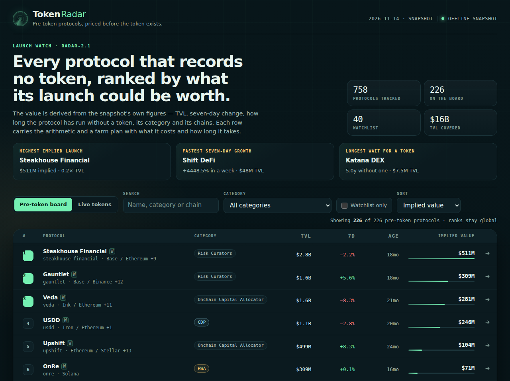

# Token Radar

[](https://make.fun/bounty/token-radar-01?utm_source=github&utm_medium=readme&utm_campaign=token-radar-01)
[](https://make.fun/bounty/token-radar-01/leaderboard?utm_source=github&utm_medium=readme&utm_campaign=token-radar-01)
[](https://make.fun/bounty/token-radar-01?utm_source=github&utm_medium=readme&utm_campaign=token-radar-01)

A pre-token launch radar built on make.fun's sealed protocol snapshot. Every protocol that records no token is scored from its own record — TVL, seven-day change, age, category, chains and record completeness — ranked by an implied launch value, and given a concrete farm plan with costs and timings. Entered in make.fun's [Build the best token launch radar](https://make.fun/bounty/token-radar-01) bounty.



## What the page does

- **Ranked board** of 226 pre-token protocols, with the 40-slug watchlist covered and 186 early protocols found below it.
- **Detail drawer** for every row: the six multiplied factors, the formula, a seven-step farm plan, a risk note and the recorded facts.
- **Filters** by category, watchlist membership, search text and sort key; the headline signals follow the filtered view.
- **Live set** of protocols whose token already trades, at market value, kept off the ranked board.

The implied value is the entry's own model claim, not a prediction that a token will be issued and not one make.fun makes. Nothing on the page fetches a network resource: every figure comes from the snapshot shipped with the entry.

## Run it

Node 22.18 or later, no dependencies:

```sh
mkdir -p out
MAKEFUN_OUTPUT_DIR=out node main.ts --input ../input/snapshot.json
```

The program reads `snapshot.json`, writes `out/board.json` and `out/data.js`, copies `dashboard/` and `screenshots/` into `out/`, and writes `out/dossier.json` last with the vendored make.fun library. Both runs produce identical bytes.

## Model

`lib/model.ts` prices a protocol as:

```
TVL × 0.22 × growth × maturity × category × chains × quality
```

Growth rewards a rising seven-day trend and penalises a falling one; maturity grows with the time a protocol has run without a token; chains add 2% each to a cap of 8%; quality discounts missing listing dates, missing change and missing chains. The model version, constants and every factor travel in `data.js`, so the page can show its own arithmetic.

## Layout

```
main.ts                 entrypoint and output gate
lib/model.ts            snapshot parsing, scoring, ranking, farm plans
dashboard/              static page (index.html, app.css, app.js)
screenshots/            board, detail and filtered views
vendor/                 make.fun dossier library, vendored unchanged
```

## License

MIT. See [LICENSE](LICENSE).
